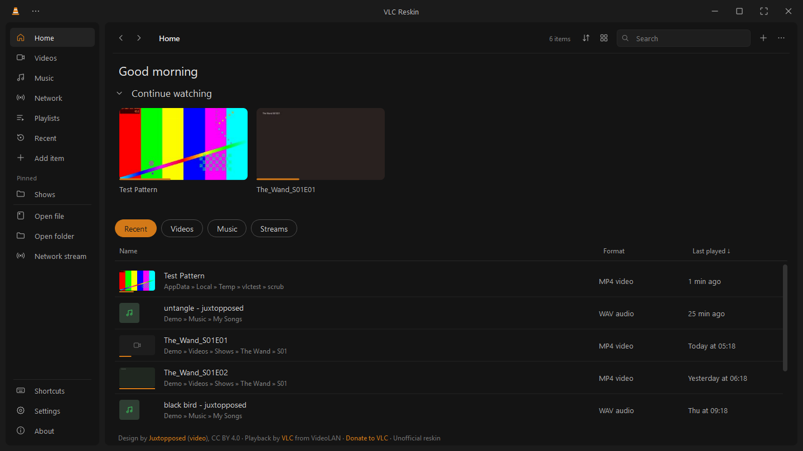
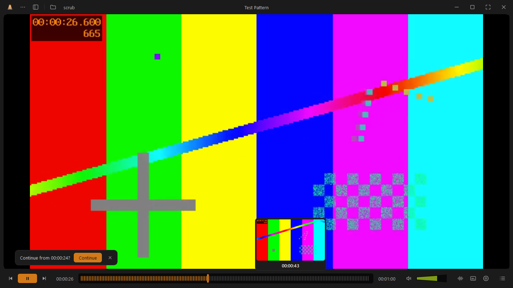
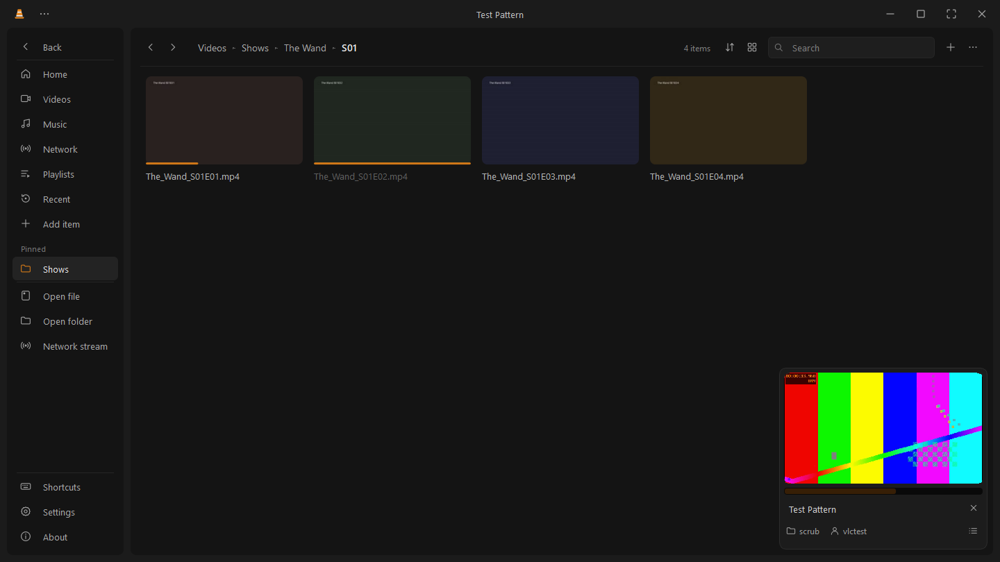
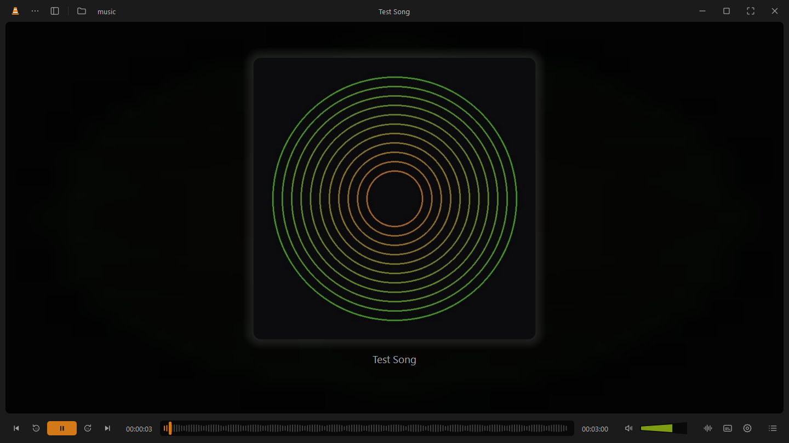
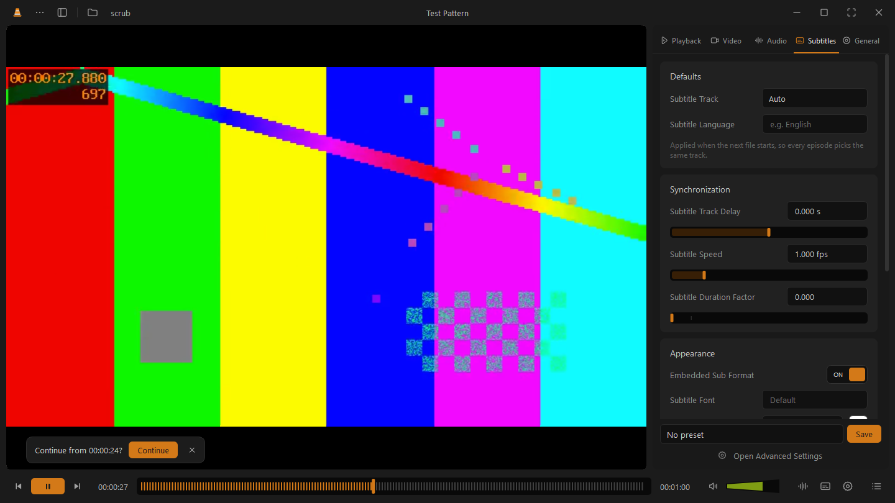

# VLC Reskin: Juxtopposed's VLC Redesign as a working app

**An unofficial reskin of VLC media player that applies [Juxtopposed](https://figma.com/@juxtopposed)'s "VLC Redesign"** (from the video *I Redesigned VLC After 25 Years*), so you can actually use the Juxtopposed VLC redesign on Windows.

> **I didn't design this, and I didn't make the player.**
> The whole design comes from Juxtopposed's video and Figma file, and every bit of playback is VLC, made by VideoLAN and its volunteers.
> This project is only a reskin: it puts that design on top of VLC so you can actually use it.
>
> **If you like it, please [donate to VideoLAN](https://www.videolan.org/contribute.html#money) to support the real VLC.**



## Credits

| | |
|---|---|
| **Design** | **Juxtopposed**: [*I Redesigned VLC After 25 Years*](https://www.youtube.com/watch?v=ERFeOgqk324) (YouTube) and the [**VLC Redesign** Figma file](https://www.figma.com/community/file/1691465999134370980), licensed [CC BY 4.0](https://creativecommons.org/licenses/by/4.0/). The layout, colours, icons style, start page idea, preferences sidebar, library, music view and mini player are all from that design and video. |
| **Player** | **[VLC media player](https://www.videolan.org/vlc/)** by **VideoLAN**, used through libVLC. Every format, codec, subtitle and stream this app plays is VLC doing the work. **[Donate to VideoLAN](https://www.videolan.org/contribute.html#money)** |
| **This reskin** | Jasim Khan: the code that applies the design to VLC (MIT licence). |

See [CREDITS.md](CREDITS.md) for the full attribution and the list of changes made to the design.

**Not affiliated with or endorsed by VideoLAN or Juxtopposed.** VLC and the VLC cone are trademarks of VideoLAN. Juxtopposed's Figma page warns that links posted in its comments aren't theirs. This is one of those fan projects, not an official release.

## Download

1. Make sure **[VLC](https://www.videolan.org/vlc/) (64-bit, version 3.x)** is installed. VLC Reskin uses your installed VLC to play everything.
2. Download `VLC-Reskin-<version>-windows-x64.zip` from the [Releases](../../releases) page.
3. Unzip it somewhere permanent (for example `Documents\VLC Reskin`). Keep the folder together: `VLC Reskin.exe` needs the `_internal` folder next to it.
4. Run **`VLC Reskin.exe`**.
5. **From now on, always open `VLC Reskin.exe` to get the new look.** It's a separate app that sits alongside VLC; it doesn't change or replace your normal VLC, so opening VLC itself still shows the classic interface.
6. *(Optional)* Make it easy to open: right-click `VLC Reskin.exe` → *Pin to Start* or *Send to › Desktop (create shortcut)*. To open your videos with it by double-clicking, right-click a video → *Open with › Choose another app* → pick `VLC Reskin.exe` and tick *Always*.

The app isn't code-signed, so the first time Windows may say *"Windows protected your PC"*: click **More info → Run anyway**. Some antivirus tools also flag PyInstaller-built apps by mistake. You can always [build it yourself](#build-from-source) instead.

Windows only for now.

## What's in it

All of these follow Juxtopposed's design and video:

- **Player:** slim control bar with a thick seek bar, cone-shaped volume, centred play button; click the video to pause, double-click for fullscreen, with a play/pause flash; top and bottom bars that appear when you hover near them in fullscreen or with Hide UI (Ctrl+\\).
- **Scrub preview:** hover the seek bar to see the frame at that point.
- **Audio / subtitle / video tracks** in one popup, including audio output devices.
- **Preferences sidebar** (Playback, Video, Audio, Subtitles, General) with subtitle sync, fonts and colours, equalizer presets, video filters, sleep timer and **per-show presets** that come back for every episode.
- **Library:** Home, Videos, Music (by album, artist, genre), Network streams (paste an `.m3u` channel list) and Playlists, as a compact sidebar or a full window with thumbnails and a draggable mini player.
- **Start screen:** recent media with where it's saved, its format and when you last played it, plus Continue watching. (Settings › General can switch Home to the original "Classic" tile layout.)
- **Music view:** big cover art and a waveform seek bar.
- **Resume:** remembers where you stopped and offers to continue.

| | |
|---|---|
|  |  |
|  |  |

## Known limitations

- Needs VLC installed; it doesn't ship its own copy of VLC.
- libVLC 3 can't play backwards or record, so those options are disabled.
- The full "Advanced Settings" window and Customize Player from the design aren't built yet.

## Build from source

Requires Windows, Python 3.12 and 64-bit VLC 3.x.

```bat
run.bat        :: run from source (creates a Python environment the first time)
build.bat      :: build dist\VLC Reskin\VLC Reskin.exe and a Desktop shortcut
```

The code is in [`player/`](player); `main.py` is the entry point. The UI uses PySide6 (Qt) and playback uses [python-vlc](https://pypi.org/project/python-vlc/).

## Licence

The reskin code is under the [MIT licence](LICENSE). The design remains Juxtopposed's under [CC BY 4.0](https://creativecommons.org/licenses/by/4.0/), and VLC, Qt and the other libraries keep their own licences. See [THIRD-PARTY-NOTICES.md](THIRD-PARTY-NOTICES.md).
